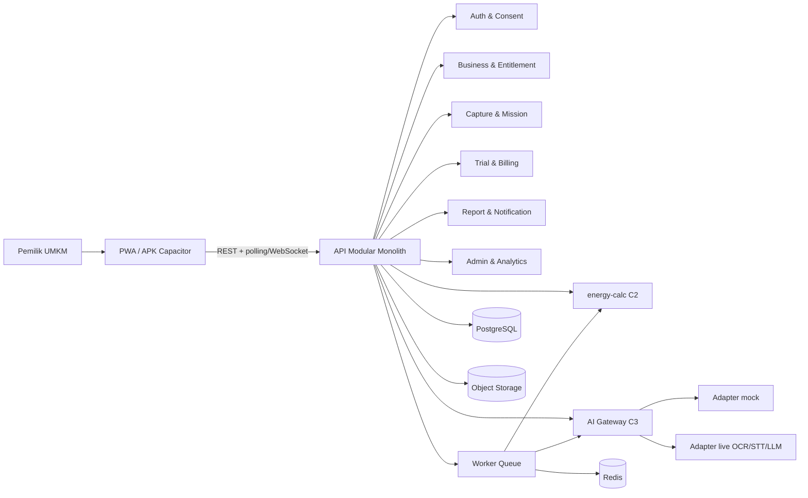

# Arsitektur Sistem

Dokumen ini merangkum keputusan arsitektur dari PRD v0.3.1 dan ADR terkait. Bila terjadi konflik, PRD adalah sumber kebenaran produk; ADR menjelaskan pilihan teknis.

## Batasan utama

- **Software-first.** Rilis awal tidak memakai sensor/AMI; tidak ada pemantauan per alat 24 jam.
- **Mobile-first dan WhatsApp-friendly.** Input foto, mikrofon, voice note, dan input manual harus nyaman di ponsel.
- **Satu mesin hitung.** Semua kWh/Rp berasal dari `energy-calc` (C2).
- **LLM tidak menghasilkan angka.** LLM hanya menyusun penjelasan dari angka yang sudah dihitung.
- **AI dapat ditukar.** FE/BE berkomunikasi lewat AI Gateway; adapter bisa `mock`, `hybrid`, atau `live`.
- **Modular monolith.** Tim kecil, waktu pendek, kontrak antarmodul tetap dijaga.
- **Privasi default.** Data dibatasi `business_id`; foto/suara disimpan privat dengan URL bertanda tangan.

## Gambaran sistem



## Modul backend

| Modul | Tanggung jawab | Kontrak |
|---|---|---|
| `auth` | OTP WhatsApp, sesi, consent | C5 |
| `business` | Profil usaha, tarif, tipe prabayar/pascabayar | C1, C5 |
| `template` | Katalog template berversi | C1 |
| `mission` | Misi, event, verifikasi, anti-curang | C4 |
| `capture` | Foto/suara, antrean, status job, koreksi | C3 |
| `trial` | Trial 30 hari sejak data asli pertama | C5 |
| `billing` | Plus, pembayaran, perpanjangan, pembatalan | C5 |
| `report` | Laporan Hari 7/Hari 30, ekspor | C2, C6 |
| `notify` | Pengingat misi, penyimpangan, batas harian | C6 |
| `admin` | Funnel, akurasi, biaya AI, feature flag | — |
| `analytics` | Event produk tanpa data sensitif | — |
| `ai` | AI Gateway, adapter, validasi, `ai_usage` | C3, C6 |

## Alur data utama

```text
Input (foto/suara/manual)
  -> capture disimpan + job_id
  -> OCR/STT (mock/live)
  -> layar konfirmasi/koreksi pengguna
  -> data terstruktur (usage_note, meter_reading, appliance)
  -> energy-calc: estimasi per alat
  -> cross-validation dengan delta meter
  -> keyakinan (Tinggi/Sedang/Rendah)
  -> rekomendasi P7 (maks. 3)
  -> Setuju / Tolak / Tunda
  -> verifikasi dampak P9
  -> laporan + progres game
```

Aturan:

- Job berat berjalan asinkron; API mengembalikan `job_id`.
- Klien memantau status lewat polling/WebSocket; status gagal dan retry terlihat.
- OCR rendah meminta foto ulang atau input manual.
- STT yang tidak yakin menampilkan `unmatched_terms`; tidak menebak.
- Gap meter tidak dibagi paksa ke alat lain.

## Pipeline AI

| ID | Pipeline | Mesin | Mode T0 | Live target |
|---|---|---|---|---|
| P1 | OCR meter | OCR/vision | mock | T1 (Des 2026–Jan 2027) |
| P2 | OCR label alat | OCR/vision | mock | T1 |
| P3 | OCR token | OCR/vision | mock | T1 |
| P4 | STT + ekstraksi | STT + LLM terbatas | mock | T2 (Jan 2027) |
| P5 | Estimasi per alat | `energy-calc` | mock | T3 (Jan–Feb 2027) |
| P6 | Cross-validation | `energy-calc` | mock | T3 |
| P7 | Rekomendasi | aturan + skor | mock | T4 (Feb 2027) |
| P8 | Penjelas | LLM tanpa angka baru | mock | T4 |
| P9 | Verifikasi dampak | `energy-calc` | mock | T5 |
| P10 | Tanya Terra | LLM + tool terbatas | mock | T5 (Mar–Apr 2027) |
| P11 | Peringatan penyimpangan | aturan statistik | mock | T5 |
| P12 | Prediksi token | aturan | mock | T5 |
| P13 | Kalkulator ROI | `energy-calc` | mock | T5 |

## Mode AI Gateway

| Mode | Perilaku | Pemakaian |
|---|---|---|
| `mock` | Fixture/skenario tetap, label **Contoh** | Pengembangan FE/BE, demo awal |
| `hybrid` | Sebagian endpoint live, sisanya mock | Transisi Des 2026–Jan 2027 |
| `live` | Pipeline sebenarnya | MVP dan pilot |

Flag per endpoint, misalnya `AI_MODE_OCR_METER=mock|live`. Dukungan nilai `hybrid` masih keputusan terbuka O30.

## Stack usulan (provisional)

| Lapisan | Pilihan | Status |
|---|---|---|
| Frontend | TypeScript + React + Next.js (PWA) | Accepted — ADR-001 |
| Mobile wrapper | Capacitor | Accepted — ADR-001 |
| Backend | TypeScript + NestJS modular monolith | Accepted — ADR-002 |
| Database | PostgreSQL | Accepted — ADR-002 |
| Queue/cache | Redis + BullMQ | Accepted — ADR-002 |
| Storage | S3-compatible object storage | Accepted — ADR-002 |
| Hitung energi | Paket TypeScript `@voltess/energy-calc` | Accepted — ADR-003 |
| Game 2D | DOM/SVG/Canvas; PixiJS hanya bila profiling menuntut | Accepted — ADR-004 |
| Test | Vitest + contract test (JSON Schema + OpenAPI); Playwright menyusul issue #9 | S1 |
| Monorepo | pnpm workspaces | S1 |
| CI | GitHub Actions (lint, typecheck, test, build) | S1 |
| Deploy | TBD | Belum diputuskan |

## Testing

| Lapisan | Isi | Pemilik |
|---|---|---|
| Unit | `energy-calc`, validator, aturan keyakinan | Mahdi/Muchsin |
| Contract | C1–C6, OpenAPI, fixture mock | Yusri |
| Integration | API + DB + queue + storage | Mahdi |
| E2E | Alur tamu → trial → laporan → saran → Plus | Yusri |
| AI evaluation | D-OCR, D-STT, golden calculation | Muchsin/Yusri |
| Accessibility | Kontras, font besar, target sentuh, tanpa suara | Dhifansa/Yusri |

## Keamanan dan privasi

- HTTPS; OTP memiliki rate limit.
- Entitlement diperiksa server pada setiap panggilan AI.
- Otorisasi per `business_id`; jangan percaya `business_id` dari klien.
- File privat + signed URL kedaluwarsa.
- Log terstruktur tanpa data pribadi; job AI punya ID korelasi.
- Admin/feature flag dibatasi dan diaudit.
- Penghapusan akun/data harus benar-benar menghapus sesuai kebijakan retensi.
- Foto/suara tidak dipakai untuk pelatihan model tanpa persetujuan.

## Keputusan terbuka yang memblokir

| ID | Keputusan | Dibutuhkan sebelum | Pemilik |
|---|---|---|---|
| O15 | Penyedia OCR/STT/LLM | Live T1/T2 (S4/S5) | Muchsin |
| O30 | Status `hybrid` di feature flag | Integrasi Gateway (S1) | Mahdi |
| O31 | Skema OpenAPI P2/P3 | Live OCR (S4) | Mahdi/Muchsin |
| O32 | Bentuk API P11–P13 | Pilot (S7+) | Mahdi/Muchsin |

O1/O4/O17 sudah ditutup pada 2026-11-06 melalui ADR-001, ADR-004, dan ADR-003. Ringkasan ada di [`docs/decisions/README.md`](decisions/README.md).
